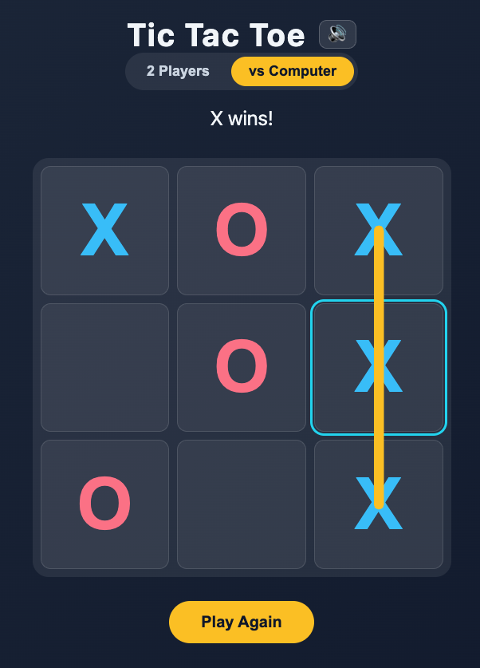

# Exercise 4: Vibe Code via Plan Mode

As you'll notice in the last exercise, its not always easy to get AI to do the work with 1 prompt. We end up going back and forth with a few more prompts to refine and fine-tune the result.

Another approach to Vibe Coding is to use Plan Mode - where you ask AI to come up with a plan first before executing.

OpenCode has a *Plan mode* that disables its ability to make changes and instead suggest how it’ll implement the feature.

## Build a simple game

1. In OpenCode, press the `<shift>` + `<tab>` key to enter *Plan Mode*.

2. Let's try to build a simple tic tac toe game.

    Copy and paste this into your OpenCode chat box:

    ```
    I want to build a simple Tic Tac Toe game that runs in the browser.

    Before writing any code:

    1. Define the requirements and game rules.
    2. Identify the main components and data structures needed.
    3. Describe the game flow from start to finish.
    4. List the functions/classes that should be implemented and their responsibilities.
    5. Identify edge cases and error handling requirements.
    6. Propose a simple project structure.
    7. Create an implementation plan broken into small, testable steps.

    Keep the design simple and suitable for a beginner developer. Do not generate code yet—focus only on planning and architecture.

    Ask me any questions that might help in the refining the plan.
    ```

3. Follow the on screen instructions and let's see what plan it comes up with.

    - Did AI ask you many questions?
    - You can also write additional prompts if you are not happy with the ones that AI offers you.

4. You can chat and discuss changes if you don't agree with anything that was suggested.

5. Remember to switch back to *Build Mode* before executing (press `<shift>` + `<tab>` key again).

    Copy and paste this into your OpenCode chat box:
    
    ```
    Write this to plan.md and let's go
    ```

6. Use VScode to see what's being added to the folder.

7. You can proceed to play the game in the browser.

8. Additional enhancements:

    - Add sounds.
    - Add a sound track.
    - Add an AI opponent.

    How might you prompt the AI to add these things?



## Things to Ponder

- Did you notice the implementation is closer to what you had in mind because the AI asked you some questions first?
- There are fewer back and forth discussion on what to build.
- There are still some visual bugs that AI can't "see".
- You can find out more about Plan Mode [here](https://opencode-tutorial.com/en/docs/modes) and [here](https://www.aihero.dev/plan-mode-introduction).

[Next Exercise >>](./exercise5.md)
